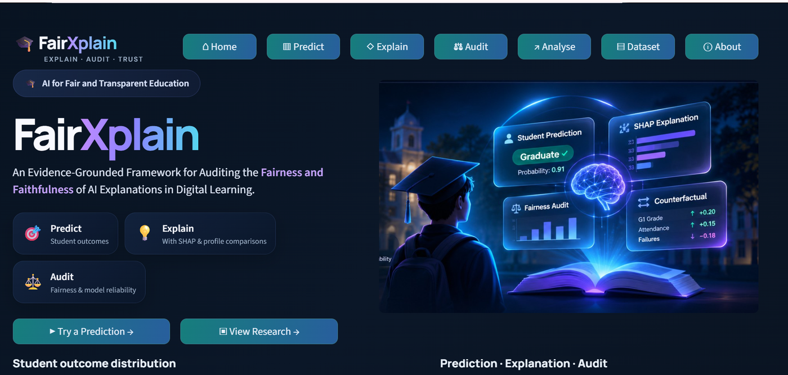
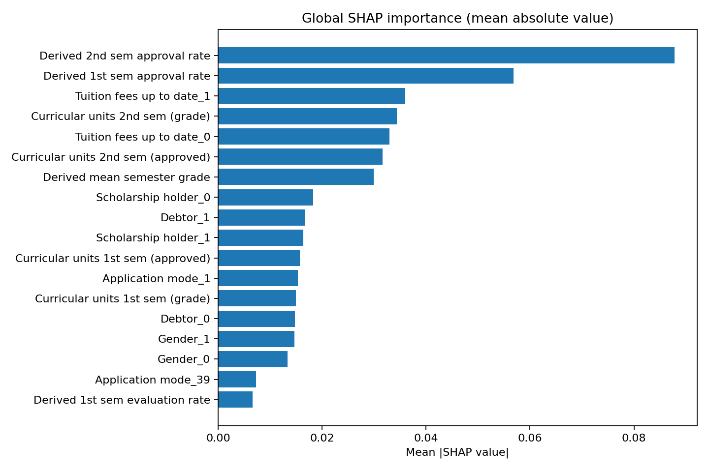
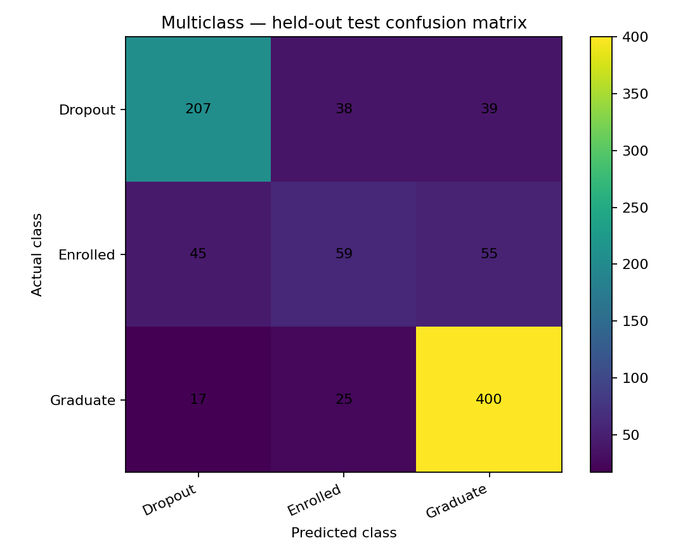
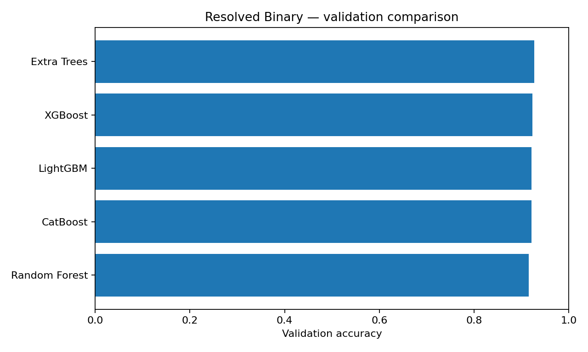
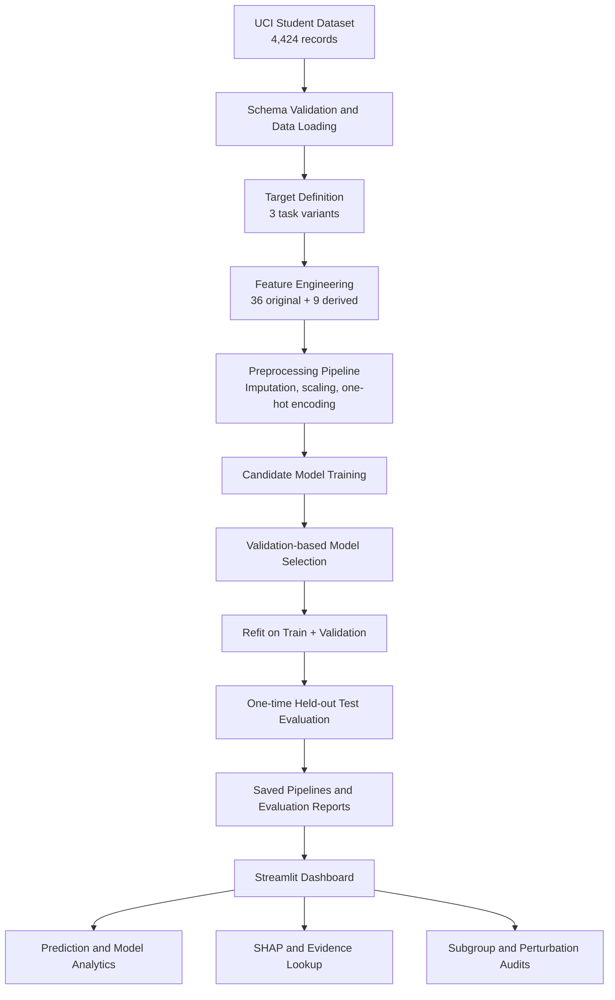

<div align="center">

# 🎓 FairXplain

### An Evidence-Grounded Framework for Auditing the Fairness and Faithfulness of AI-Generated Explanations in Digital Learning

[](https://fairxplain-xai-hqlflw7vnhhshqc5d7c9gh.streamlit.app/)
[](https://www.python.org/)
[](https://streamlit.io/)
[](https://doi.org/10.24432/C5MC89)
[](LICENSE.txt)

**Explain · Audit · Trust**

[Open the live application](https://fairxplain-xai-hqlflw7vnhhshqc5d7c9gh.streamlit.app/) · [View source on GitHub](https://github.com/Anandreddy-1010/fairxplain-xai)

</div>

---

## 📱 Scan to Open

<div align="center">


**Scan with your phone camera to open the deployed FairXplain dashboard.**

</div>

## 📋 Table of Contents

- [Overview](#overview)
- [Screenshots](#screenshots)
- [Problem Statement](#problem-statement)
- [Objectives](#objectives)
- [Dataset and Prediction Tasks](#dataset-and-prediction-tasks)
- [System Architecture](#system-architecture)
- [Model Details and Evaluation](#model-details-and-evaluation)
- [Explainability and Evidence Grounding](#explainability-and-evidence-grounding)
- [Fairness and Faithfulness Auditing](#fairness-and-faithfulness-auditing)
- [Dashboard Workspaces](#dashboard-workspaces)
- [Technology Stack](#technology-stack)
- [Features](#features)
- [Performance Results](#performance-results)
- [Deployment](#deployment)
- [Project Structure](#project-structure)
- [Setup and Installation](#setup-and-installation)
- [Research Scope and Limitations](#research-scope-and-limitations)
- [Future Improvements](#future-improvements)
- [Citation and License](#citation-and-license)
- [Conclusion](#conclusion)

## Overview

**FairXplain** is a research prototype for student-outcome classification that connects model prediction with inspectable explanation evidence and responsible-AI evaluation. It uses structured educational records from the UCI *Predict Students' Dropout and Academic Success* dataset and provides a Streamlit interface for exploring predictions, model performance, SHAP attributions, observed-profile contrasts, subgroup metrics, and feature-perturbation sensitivity.

The project is organized around three connected activities:

1. **Predict** — classify student outcomes using reproducible machine-learning pipelines.
2. **Explain** — inspect global and individual model attributions and retrieve documented definitions for selected dataset fields.
3. **Audit** — examine subgroup performance and how predictions respond when individual features are perturbed.

FairXplain is intended for research and human decision support. It is not an automated decision system and should not be used to make high-stakes decisions about individual students.

## Screenshots

### Live application — Home

<div align="center">



<sub>Deployed Streamlit dashboard. The hero artwork contains illustrative UI elements; values drawn inside that artwork are not experimental results.</sub>

</div>

### Model explanation — global SHAP importance



### Primary task — held-out test confusion matrix



### Validation model comparison



Additional figures and task-specific artifacts are available in the [`figures/`](figures/) and [`reports/`](reports/) directories.

## Problem Statement

Student-outcome models can produce predictions without making their reasoning easy to inspect. A single aggregate score can also hide differences in performance across student groups. In educational settings, explanations may be misunderstood as causal advice, and a model's predictive performance does not by itself establish that its explanations are faithful or that its behaviour is fair across groups.

FairXplain addresses these concerns by combining student-outcome prediction with model attribution, documented feature definitions, descriptive subgroup analysis, and perturbation-based sensitivity checks in one review workflow.

| Challenge | FairXplain response |
|---|---|
| Predictions can be difficult to inspect | Show task-specific predictions and model performance metrics |
| Feature attributions can be misinterpreted | Display SHAP evidence with interpretation boundaries and feature definitions |
| What-if examples can be mistaken for causal instructions | Use nearest observed training profiles as descriptive contrasts |
| Aggregate metrics can hide subgroup differences | Report group-level support and performance measures |
| Feature importance alone does not test model reliance | Run validation-only feature-perturbation sensitivity checks |

## Objectives

- Build reproducible pipelines for student-outcome classification using public educational data.
- Compare multiple tree-based machine-learning candidates using a validation partition.
- Keep the final test partition separate from model selection.
- Generate global and individual SHAP attribution evidence where supported by the fitted model.
- Retrieve documented UCI feature definitions to add context to model explanations.
- Compare performance across selected demographic and background groups.
- Inspect model reliance through controlled feature perturbations on validation data.
- Provide an interactive dashboard that connects prediction, explanation, analytics, and audit outputs.

## Dataset and Prediction Tasks

### Primary dataset

FairXplain uses the UCI Machine Learning Repository dataset **Predict Students' Dropout and Academic Success** (dataset ID **697**; DOI: [10.24432/C5MC89](https://doi.org/10.24432/C5MC89)). The bundled CSV is located at `data/raw/data.csv`.

| Dataset property | Description |
|---|---|
| Records | 4,424 |
| Original predictors | 36 |
| Target classes | Dropout, Enrolled, Graduate |
| Source | One higher-education institution in Portugal |
| Additional variables | Demographic, admission, socioeconomic, and semester-performance fields |
| Engineered inputs | 9 derived ratios/deltas, producing 45 model inputs |

### Three separate prediction tasks

The application supports three task definitions. Their results represent different target definitions and populations and must not be treated as interchangeable.

| Task | Target definition | Treatment of Enrolled |
|---|---|---|
| **Multiclass — primary** | Dropout / Enrolled / Graduate | Retained as its own class |
| **Binary — secondary** | Dropout vs. Not dropout | Combined with Graduate in Not dropout |
| **Resolved binary — secondary** | Dropout vs. Graduate | Excluded from this task |

The multiclass and binary experiments use 2,875 training, 664 validation, and 885 held-out test records. The resolved-binary experiment excludes Enrolled records before splitting and uses 2,359 training, 545 validation, and 726 held-out test records. All experiments use stratified partitions and random seed 42.

## System Architecture



### Training and evaluation flow

1. Load and validate the official UCI CSV and its target classes.
2. Define one of the three prediction tasks.
3. Engineer nine documented semester ratios and deltas from existing columns.
4. Split the data into train, validation, and held-out test partitions using stratification.
5. Fit imputation, scaling, and categorical encoding inside the model pipeline using training data.
6. Compare candidate models on validation accuracy; macro F1 is also recorded.
7. Refit the validation-selected model on the combined training and validation data.
8. Evaluate the selected model once on the untouched test partition and save the artifacts.

## Model Details and Evaluation

Five candidate learners are compared in the executed compact workflow:

| Candidate | Model family |
|---|---|
| XGBoost | Gradient-boosted decision trees |
| LightGBM | Gradient-boosted decision trees |
| CatBoost | Gradient-boosted decision trees |
| Random Forest | Bagged decision trees |
| Extra Trees | Extremely randomized trees |

The preprocessing pipeline uses median imputation and standard scaling for numeric fields, and most-frequent imputation plus one-hot encoding for categorical fields. Model selection is based on validation accuracy. The untouched test partition is not used for model selection. The reported compact run did not apply SMOTE or Optuna hyperparameter search; those packages are present in the dependency list but are not claimed as completed experiment steps.

## Explainability and Evidence Grounding

### SHAP attribution

- **Global explanations:** task-specific mean absolute SHAP values are calculated from a sample of validation records and saved as tables and figures.
- **Individual explanations:** the dashboard can display local SHAP attributions for supported fitted tree pipelines and a selected student profile.
- SHAP values describe how the fitted model uses its input features; they do not demonstrate that a feature causes an educational outcome.

### Feature-definition evidence lookup

A local, deterministic retrieval layer matches selected feature names to definitions from the UCI dataset documentation. It returns the field meaning, source reference, and a boundary note where available. This component explains what a recorded field represents; it is **not** an LLM-based explanation generator or a complete retrieval-augmented generation (RAG) system.

### Observed-profile contrasts

The dashboard can show nearest observed training profiles from another outcome class. Selected protected or sensitive fields are omitted from the displayed differences. These records are descriptive examples, not causal counterfactual interventions or recommendations for changing a student's circumstances.

## Fairness and Faithfulness Auditing

### Descriptive subgroup analysis

Subgroup metrics are computed on held-out test predictions for available attributes including:

- Gender
- Scholarship-holder status
- Tuition-fee status
- Age at enrollment and derived age groups
- Nationality (the source dataset column is named `Nacionality`)

The audit reports subgroup support, accuracy, macro F1, predicted dropout rate, and class-specific recall where applicable. Groups with fewer than 20 records are omitted from the grouped table. The output is descriptive, not a legal fairness certification or proof of equal treatment.

### Perturbation-based sensitivity check

A validation-only audit permutes one feature at a time and measures the resulting change in model accuracy. This indicates how much the fitted model relies on a field under the tested permutation procedure. It is not a causal test and does not, by itself, prove that SHAP explanations are faithful.

## Dashboard Workspaces

The deployed Streamlit application presents the following workspaces:

| Workspace | Purpose |
|---|---|
| **Home** | Project overview and student-outcome distribution |
| **Predict** | Enter a student profile and view a task-specific model prediction |
| **Explain** | Inspect SHAP evidence, feature definitions, and observed-profile contrasts |
| **Audit** | Review subgroup performance and fairness-related summaries |
| **Analyse** | Compare model metrics, validation candidates, confusion matrices, and per-class results |
| **Dataset** | Explore records, target distribution, and numeric feature distributions |
| **About** | Review project context and research scope |

The selected prediction task is shared across the prediction, explanation, analytics, and audit views so that metrics and outputs remain tied to the same task definition.

## Technology Stack

| Area | Technology | Role |
|---|---|---|
| Language | Python | Data processing, modelling, and application logic |
| UI and deployment | Streamlit | Interactive research dashboard and cloud hosting |
| Data handling | pandas, NumPy | Dataset loading, transformation, and analysis |
| Machine learning | scikit-learn | Pipelines, preprocessing, evaluation, and tree ensembles |
| Gradient boosting | XGBoost, LightGBM, CatBoost | Candidate classification models |
| Explainable AI | SHAP | Global and local feature attribution |
| Visualization | Plotly, Matplotlib, Seaborn | Interactive dashboard charts and saved figures |
| Model persistence | joblib | Saving and loading fitted pipelines and encoders |
| Testing | pytest | Core project tests |

## Features

### Student-outcome prediction

- Three-class and two binary task definitions.
- Shared task selection across dashboard workspaces.
- Saved preprocessing and model pipelines for repeatable inference.
- Model output and probability information where supported by the fitted pipeline.

### Model analytics

- Held-out test accuracy, macro F1, and balanced accuracy.
- Validation comparison across the five candidate learners.
- Confusion matrix and per-class precision, recall, F1-score, and support.
- Clear separation of validation-based selection and final test evaluation.

### Explainability and audit

- Global SHAP importance figures and tables.
- Individual model attribution for supported tree pipelines.
- UCI feature-definition retrieval and interpretation notes.
- Nearest observed-profile contrasts.
- Descriptive subgroup metrics and validation perturbation sensitivity reports.

## Performance Results

The following are the saved results from the executed experiments on untouched held-out test partitions. **The three rows correspond to different prediction tasks and different populations.**

| Task | Selected model | Test accuracy | Balanced accuracy | Macro F1 | Test records |
|---|---|---:|---:|---:|---:|
| **Multiclass — primary** | XGBoost | **75.25%** | 66.83% | 0.6744 | 885 |
| Binary — Dropout vs. Not dropout | Random Forest | **87.91%** | 84.88% | 0.8576 | 885 |
| Resolved binary — Dropout vs. Graduate; Enrolled excluded | Extra Trees | **91.18%** | 90.18% | 0.9063 | 726 |

The primary research task is the three-class classification problem. The 91.18% score belongs only to the resolved-binary task, which excludes Enrolled records; it must not be presented as the three-class accuracy. The 95% accuracy threshold was an experimental target and was not achieved in these saved runs.

Detailed reports are available in `reports/<task>/`, including `final_test_metrics.json`, `classification_report.csv`, `confusion_matrix.csv`, `validation_model_comparison.csv`, `fairness_group_metrics.csv`, `faithfulness_perturbation_audit.csv`, and SHAP importance artifacts.

## Deployment

### Live application

FairXplain is deployed on **Streamlit Community Cloud**:

**[https://fairxplain-xai-hqlflw7vnhhshqc5d7c9gh.streamlit.app/](https://fairxplain-xai-hqlflw7vnhhshqc5d7c9gh.streamlit.app/)**

### Deploy your own copy

1. Fork or clone this repository.
2. Make sure `app.py`, `requirements.txt`, `src/`, `models/`, `data/`, `reports/`, and `figures/` are present at the repository root.
3. Open [Streamlit Community Cloud](https://share.streamlit.io/) and sign in with GitHub.
4. Create an app using this repository, branch `main`, and entry point `app.py`.
5. In Advanced settings, select Python **3.13** to match the checked model-artifact environment.
6. Deploy and review the application logs if the build reports an error.

The current prototype uses bundled model, dataset, and report files and does not require API secrets. Do not commit passwords, tokens, `.env` files, or private Streamlit secrets.

## Project Structure

```text
fairxplain-xai/
├── app.py                         # Streamlit dashboard entry point
├── requirements.txt               # Pinned Python dependencies
├── data/
│   ├── raw/data.csv                # UCI source dataset
│   └── processed/                  # Task-specific model inputs and predictions
├── models/
│   ├── multiclass/                 # Three-class pipeline and encoder
│   ├── binary/                     # Dropout vs. Not dropout pipeline
│   └── resolved_binary/            # Dropout vs. Graduate pipeline
├── reports/                        # Metrics, fairness, SHAP, and audit outputs
├── figures/                        # Confusion matrices, SHAP, and comparison plots
├── src/fairxplain/                  # Data, features, pipelines, metrics, XAI, audits
├── scripts/                        # Training, explanation, verification, report scripts
├── tests/                           # Core project tests
├── docs/                            # Dataset notes and research protocol
├── CITATION.bib                     # Dataset/research citation metadata
├── LICENSE.txt                      # Project and dataset license notes
└── README.md
```

## Setup and Installation

### Prerequisites

- Python 3.12 or 3.13 (Python 3.13 is selected for the Streamlit Cloud deployment).
- Git.
- Windows, macOS, or Linux.

### Clone the repository

```bash
git clone https://github.com/Anandreddy-1010/fairxplain-xai.git
cd fairxplain-xai
```

### Create and activate a virtual environment

**Windows PowerShell**

```powershell
py -3.12 -m venv .venv
.\.venv\Scripts\Activate.ps1
```

**macOS / Linux**

```bash
python3 -m venv .venv
source .venv/bin/activate
```

### Install dependencies

```bash
python -m pip install --upgrade pip
python -m pip install -r requirements.txt
```

### Run the dashboard locally

```bash
python -m streamlit run app.py
```

Streamlit prints a local URL (usually `http://localhost:8501`) in the terminal.

### Reproduce the model experiments

The default compact workflow trains the three task variants and writes the associated model and report artifacts:

```bash
python scripts/train.py --task both
```

To regenerate explanation and perturbation artifacts, then rebuild the research summary:

```bash
python scripts/create_explanations.py
python scripts/build_report.py
```

Training overwrites the saved artifacts for the selected tasks. Keep a copy of existing outputs before rerunning experiments if you need to preserve the current reported results.

## Research Scope and Limitations

- **End-of-course classification:** The dataset includes first- and second-semester academic-performance fields. The prototype is not an admission-time or first-semester early-warning system.
- **Single-institution source:** The UCI data represents one higher-education institution in Portugal; results should not be assumed to generalize to other institutions or countries.
- **Different task populations:** Multiclass, binary, and resolved-binary results are separate experiments and must be reported separately.
- **Explanations are not causes:** SHAP values and observed-profile contrasts describe model associations or similarities, not causal effects or interventions.
- **Fairness summaries are descriptive:** Group metrics are not a legal compliance assessment or proof of fairness.
- **Faithfulness checks are limited:** The feature-permutation audit measures model reliance under perturbation; it does not certify explanation faithfulness.
- **No completed LLM + RAG generator:** Feature-definition retrieval is deterministic and dictionary-based; a complete LLM/RAG explanation generation component is not claimed as implemented.
- **Human oversight required:** Outputs are research decision-support information, not final decisions about students.

## Future Improvements

| Direction | Potential contribution |
|---|---|
| External validation | Evaluate on a second educational dataset after harmonizing outcome definitions and features |
| Stronger explanation evaluation | Add deletion/insertion, stability, and explanation-agreement tests with documented protocols |
| Evidence-grounded language generation | Investigate an LLM + RAG layer with citations and safeguards, then audit its faithfulness separately |
| Fairness analysis | Add uncertainty intervals, subgroup sample-size warnings, and sensitivity to proxy features |
| Model robustness | Evaluate distribution shift, missingness, and input perturbations across cohorts |
| Human-centered evaluation | Study whether instructors can correctly interpret and appropriately use explanation outputs |
| Deployment controls | Add authentication, access controls, monitoring, and institution-specific governance before any operational use |

## Citation and License

### Dataset citation

Realinho, V., Vieira Martins, M., Machado, J., & Baptista, L. (2021). *Predict Students' Dropout and Academic Success* [Dataset]. UCI Machine Learning Repository. [https://doi.org/10.24432/C5MC89](https://doi.org/10.24432/C5MC89). Dataset license: **CC BY 4.0**.

### SHAP reference

Lundberg, S. M., & Lee, S.-I. (2017). A Unified Approach to Interpreting Model Predictions. *Advances in Neural Information Processing Systems*, 30.

### Software license

The project source code is released under the **MIT License**. The bundled UCI dataset is separately subject to its **CC BY 4.0** license and attribution requirements. See `LICENSE.txt` for the project license notes.

## Conclusion

FairXplain provides an integrated research workflow for student-outcome prediction, model explanation, and responsible-AI review. By keeping task definitions separate and connecting held-out performance with SHAP attribution, documented feature definitions, subgroup metrics, and perturbation sensitivity checks, the prototype makes it easier to inspect both what a model predicts and what its evidence can—and cannot—support.

The project is an academic research prototype. Its results are tied to the selected UCI dataset, task definitions, splits, and saved model artifacts; further external validation and human-centered evaluation are needed before considering operational use.

---

<div align="center">

**FairXplain — Explain · Audit · Trust**

Built with Python · Streamlit · scikit-learn · XGBoost · LightGBM · CatBoost · SHAP

[Live Demo](https://fairxplain-xai-hqlflw7vnhhshqc5d7c9gh.streamlit.app/) · [GitHub Repository](https://github.com/Anandreddy-1010/fairxplain-xai)

</div>
